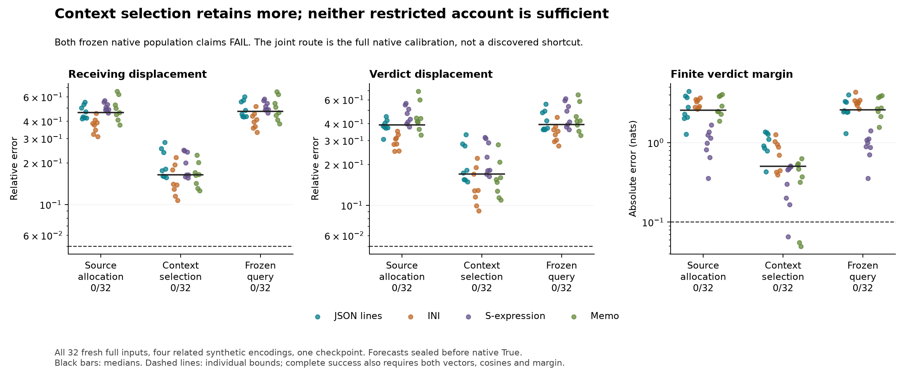
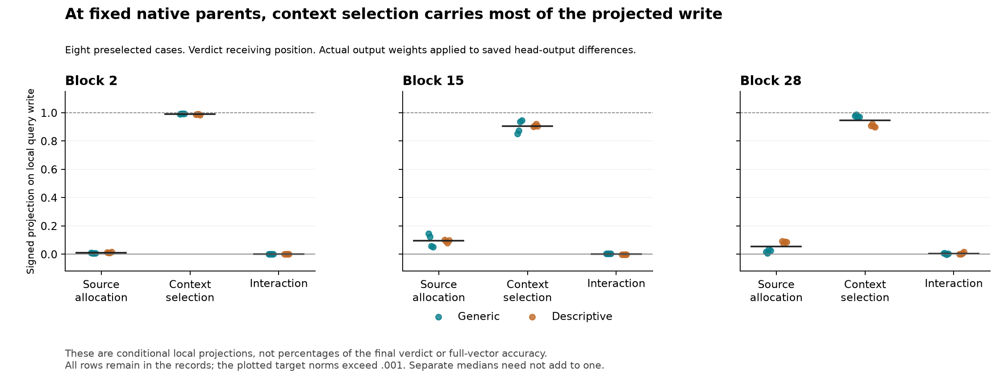

# Context selection recovers more; neither restricted route is sufficient

**Both preregistered sufficient accounts fail.** Allowing query adaptation only
in source attention allocation passes **0/32** complete native tests. Allowing
it only in selection among other positions also passes **0/32**. The frozen-query
comparator passes0/32. Both population claims fail; the separate conditional
query-effect criterion also gives0/32 for both routes. General Question B remains open.

The comparison nevertheless constrains native propagation. Context selection
has **16.44%** median receiving-vector error and **.504nat** median margin error;
source allocation has **46.11%** and **2.562nats**. Frozen queries have47.08% and
2.576nats. Preserving selection among other positions retains substantially
more of the response, while neither restricted rule explains it accurately.

All **39,368 required checks pass**, including the31,832 pre-native checks.
All288 raw-logit diagnostics also pass in this experiment. This does not repair
296's56/168 failed raw diagnostics or any older derivative disagreement.

## A probability split, rather than a raw-score split

296 showed that query orientation matters much more than query magnitude under
its interventions. It did not identify what information the turn reweights.
The alternative hypotheses here ask about two aspects of attention:

- **S, source allocation:** how much probability goes to the changed Boolean
  rather than all other positions.
- **C, context selection:** which other positions receive the remaining mass.

Let p be the attention distribution from the current query, and b the one from
the observed False query, with the candidate's CURRENT keys in both. Define
alpha=p(source) and beta as the conditional distribution over non-source keys.
Use a separate source-excluded softmax to compute beta without dividing nearly
zero remaining mass. The four probability policies are:

- S uses current alpha and False-query beta.
- C uses False-query alpha and current beta.
- B uses the full False-query distribution.
- N uses the full current distribution, executed as native T and calibration O
  only after all forecasts are sealed.

An unexecuted draft split raw query-score changes by key column. That split was
abandoned before freezing: a common score offset changes none of the attention,
yet splitting it across columns creates artificial effects. The adopted alpha/
beta split is invariant to complete-row score offsets. Tiny fixtures explicitly
check this. This is ordinary probability algebra, not a new attention mechanism.

Alpha depends on both the source score and the other scores' logsumexp. S is
therefore not solely a source-key intervention. C includes unchanged prefix
positions and other receiving positions. It is not exclusively evidence text.
The hybrids need not correspond to a realizable query vector.

## Information budget and the frozen alternatives

Each candidate sees one ordinary False query trace, the known edit and weights.
It generates all later states itself. Source and earlier rows remain protected;
all current keys/values, normalizations, MLPs, residuals and the finite full-
vocabulary head remain live. Source values still transmit information in C and B.
Holding query-mediated source allocation fixed does not remove source communication.

The original attention, both QK calculations and extra conditional softmax work
execute before replacement. This is a native-path intervention experiment with
a substantial budget, not a cheap predictor. No native True hidden state, score
or gradient enters any candidate. Different evolving histories mean the final
policy interaction is not a unique attribution at common native inputs.

32 new full-input pairs cross four familiar evidence encodings, two schemas,
two fact orders and two targets, with fixed new literals. All64 hashes are absent
from the available2,304-hash catalog. These remain dependent synthetic templates
in one Qwen2.5-1.5B-Instruct checkpoint. Fresh inputs are not independent task
domains or replications, and earlier grounding failures remain failures.

The133 scientific sources were frozen at
`7afdcc5` before checkpoint execution. All forecasts, zero controls and the
independent audit were completed before public global seal
[`3c031b3`](https://github.com/romrom-20/counterfactual-traces/commit/3c031b37c872520d61063f0395bad0c4af2a238a).
The native phase verified remote head, public seal bytes, source/runtime identities
and every forecast archive/metadata hash before its first ordinary True call.

Complete success requires both receiving and verdict displacements within5%
relative error and.99cosine, native norms>=.001, and actual margin error<=.10nat.
H1 required S to pass24/32 and6/8 in EACH encoding while C/B each pass<=8/32.
H2 required C under the analogous S/B restriction. Every arm has0/32, with no
encoding successes. Neither hypothesis can be rescued by medians.

The separate conditional target compares S-B and C-B with T-B, requiring25%
vector error,.95cosine,>=.001norm,.10nat margin error and a.02nat material margin
effect. It also passes0/32 throughout. In particular, C's median query-effect
verdict-vector error is43.34%, despite a median signed projection of88.33%.
A large projection is not a complete vector explanation.

The whole-policy interaction T-S-C+B has4.16% median signed query-effect verdict
projection, but25.95% median relative norm. S has6.77% projection and34.38% norm.
Separate medians do not add to one; small projections do not imply small vectors.
These are descriptive signed comparisons, not newly successful hypotheses.

## At identical native parents

Eight cases were selected in advance: both schemas,order0,target0 in each layout.
At blocks2/15/28 the saved native queries, False queries, shared current K/V and
mask define all four local probability policies at exactly the same inputs.
The actual attention output weights project their saved head-output differences
in CPUFloat64. All receiving positions are retained; the figure shows verdict
rows. This is retrospective local diagnosis, separate from the sealed forecasts.

At those verdict rows, C-B has median signed projection98.94%,90.63% and94.49%
on the local N-B write in blocks2/15/28. S-B has1.06%,9.64% and5.56%. These
measurements support the context-selection distinction at the sampled inputs;
they are not percentages of the final verdict or evidence of complete accuracy.

The fixed-parent interaction has an explicit form. For source value V_s,
False-query conditional context write cF, and changes Delta alpha,Delta c:

    Delta y = Delta alpha*(V_s-cF) + (1-alphaF)*Delta c - Delta alpha*Delta c.

The terms are S-B, C-B and the interaction. A numerical bridge validates this
real-valued identity against runtime Float32 corner outputs. It does not name a
learned feature. Grouping the same weighted-value difference by prefix/source/
receiving keys gives an algebraic readout, not three further causal interventions.
At block28 verdict rows, the prefix group has92.28% median signed projection;
the source has7.42%. Earlier unchanged positions can carry learned contextual
summaries, so token category alone cannot identify what information was used.

## What this explains, and what it leaves open

The query feedback is poorly described as merely adjusting how strongly the
Boolean source is read. Its selection among other positions retains much more
of this response. That is compatible with250b's source-value necessity result:
changed source information can be needed to create later states while those
states use their queries to select other contextual messages. The studies use
different related inputs and interventions; this is a consistent partial picture,
not an independently isolated complete causal chain.

Neither probability route alone predicts complete native vectors or margins.
The remaining task is to identify and directly intervene on the learned messages
that generate the query change and its consequential context reads. These results
do not justify another alpha/beta threshold or geometry sweep, or a claim that a
small circuit has been found. Any position-level hypothesis needs finite removal/
restoration controls and transfer before being promoted to an explanation.

## Numerical scope, work and reproduction

Tiny CPU qualification passes2,184 checks across four unequal lengths and36
tiny full forwards, including both phases, gauge invariance, zero/protected
rows, common-parent identities and coherent wrong-allocation/source corruptions.
The standalone reproduction's separate CPU I/O test adds18 tiny forwards and
1,088 checks. These fixtures are not checkpoint confirmations.

Pre-native audit passes31,832 checks; the complete audit39,368 includes them.
Witness coverage is96 forecast kernels plus48 native/calibration kernels,
288 current/False raw-QK comparisons. Exact query-bank, installation, prefix,
source and zero controls pass; native/current-attention calibration replays all
receiving traces and scores exactly. Independent CPU64 probability/PV bounds
are1e-4, hybrid-map2e-7, probability sums1e-6, finite-head bridge.005. These checks
cover selected kernels, not a separate full implementation of all28 blocks or
an independent research team. No whole-block derivatives are used.

Actual checkpoint work is224 forecast plus64 native/calibration full forwards:
**288 total**, with12,640 additional full QK products,18,960 softmax operations
and6,704 PV products. CPU audits and output-map projections add host work. Model
production takes97.55s and33.26s; audits6.05s and6.60s on the recorded Mac. These
include loading/collection and are not performance benchmarks.

Forecast/witness archives total215,166,594bytes; native/witness94,399,630bytes;
fixed output maps13,360,793bytes. All predeclared caps and the8GiB reserve pass.
The one shared checkpoint is reused; no historical experiment was repeated or
pruned. Raw arrays remain local, with hashes/shapes recorded publicly.

The stdlib verifier checks source ancestry, ordering, metadata, work, thresholds
and vector-statistic arithmetic. It does not reconstruct omitted arrays or rerun
the checkpoint. The standalone reproduction repeats already-public numerical
inputs with per-case native measurements; it explicitly does not create another
global prospective seal. No private article is included.

[Protocol](../experiments/297-query-routes.md) ·
[All records](../../results/query-routes-297/README.md) ·
[Standalone reproduction](../../research/README.md#query-routes-297)
