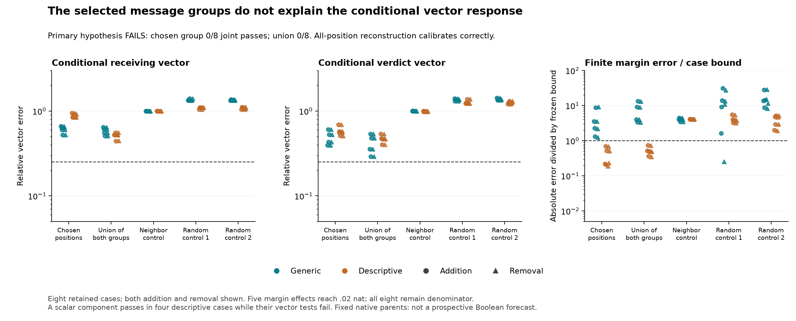

# Selected positions reproduce a scalar contrast, not the conditional vectors

**The frozen message-group hypothesis fails0/8.** The schema-chosen group,
swapped group, union, complement, neighboring positions and both matched-norm
random controls all pass0/8 complete conditional tests. The groups suggested
by the previous attention-write projection do not explain the full receiving
or verdict displacement after finite continuation. General Question B is open.

There is a narrower scalar component: the chosen group passes the addition AND
removal margin bounds in all four descriptive cases. It passes none of the four
generic cases. The neighbor, swapped and random controls pass no scalar cases.
This does not rescue the failed vector-and-margin hypothesis or identify a
learned circuit. Three cases are below the frozen.02nat materiality guard and
remain failures in the denominator; only five conditional effects are material.

## What was actually tested

297 found that preserving query-mediated context selection retains more of the
native response than preserving source allocation alone. A subsequent private
posthoc readout at its final-block verdict query suggested two position classes:
message-end positions in generic prompts, and instruction Boolean-value positions
in descriptive prompts. Large signed projections did not establish causality,
full-vector accuracy or the meaning of those states.

This test uses ALL eight previously selected297 witnesses, not a new sample:
four evidence encodings, two schemas,order0,target0. Source code, position sets,
parent hashes and criteria were frozen at`cdc7748` before the new intervention
outcomes. The native inputs were already known. Freezing a retrospective test
does not make it a prospective forecast or independent confirmation.

At the native pre-block28 receiving inputs, compare the saved current-query
attention probabilities with False-query probabilities at the SAME native K/V.
For each position group compute its weighted-value write change and apply the
actual attention output weights. The group sets are fixed:

- G, chosen:message-end positions for generic; true/false token variants in the
  system instruction for descriptive, before its first message end.
- X swaps those choices; U uses their union; H uses all keys except G.
- J chooses the nearest preceding unused non-group positions, matching G's count.
- R1/R2 are seeded random residual directions matched to G's norm at each row.
- A uses every key position as a reconstruction control; Z uses none.

For each group, add its write change to the frozen-query attention write, or
remove it from the native-query write. Execute the actual last RMSNorm/MLP,
residual update, final RMSNorm and FULL vocabulary head. Earlier rows are padded
to retain the original full matrix shape; only the supplied native receiving
rows are evaluated. After attention these operations are row-wise. The native
receiving states and scores replay EXACTLY in all eight cases before any further
terminal intervention executes.

No query, key, value, source trajectory or earlier receiver state is regenerated.
No full transformer forward runs. This is a conditional native-input test, not
an answer predicted from False alone. Group write changes need not correspond
to a realizable attention distribution; their effects include softmax competition.
Token labels do not name learned features, and message-end states may contain
rich summaries of preceding context.

## The stronger criterion, and why it fails

The target is the local final conditional difference N-B, rather than the much
larger native True-False response. Both receiving and verdict target norms must
be>=.001. The addition effect AND removal effect must each match the target
within25% relative error and.95cosine. Both finite margin errors must be at most
min(.10nat,.25*|marginN-marginB|), with that target magnitude at least.02nat.

H1 requires G to pass6/8,3/4 per schema and1/2 per encoding, while X,H,J,R1,R2
each pass<=2/8. G passes0/8; U cannot rescue it. Only five cases reach the margin
guard, already preventing the6/8 population criterion. The groups nevertheless
also fail the vector criteria throughout, including the material cases.

Across addition and removal, G has75.37% median receiving-vector error and54.45%
verdict error, despite.0105nat median margin error. U has53.88% receiving error
and46.98% verdict error. The scalar-only4/8 is an explicitly separate component
of the frozen criterion; it is not a newly successful primary hypothesis.

This is not chiefly a small correct message being distorted later. Before the
terminal MLP, G already misses the whole attention-write change by52–95% across
the eight cases; U misses48–68%. The position classes selected by a verdict-row
projection do not reconstruct the full message across receiving rows. Do not
interpret the shortfall as an identified nonlinear amplifier or intrinsic lack
of sparsity. Other position sets were not tested.

The all-position control reconstructs both finite endpoints accurately in every
case. Its median conditional receiving error is.00222%; its5/8 joint count is
exactly the five material cases. The remaining three stay ineligible failures.
The zero-group final states and scores match the appropriate baseline exactly.

## A bounded interpretation

The instruction Boolean positions have a tested conditional margin effect in
the four descriptive examples. Their actual values depend on the preceding
instruction, so this is not evidence of a lexical Boolean feature or a universal
copying circuit. The complete vector account is rejected even in those cases.

The final-block query contrast is small in this cohort: absolute margin changes
range from.00467 to.26423nat, while the full input-Boolean contrasts range from
.39231 to9.85633nats. These are different, interacting interventions, not a
unique percentage allocation of the original response. A final-block scalar
account would not by itself explain the earlier generation and propagation.

This closes the tested position-label account. It does not license selecting
more token groups or layers until a favorable result appears. The useful next
question concerns the earlier generation of consequential queries and residual
changes, with a native computational target. Another supplied-state readout or
accurate final scalar would not complete Question B.

## Numerical qualification, including the failures

The original audit passes1,424 required checks under its PREDECLARED boundary.
Native replay and zero/installation checks are exact. Independent finite CPU64
MLP reconstruction requires max state error<=1e-3 AND relative L2<=1e-5; finite
head bridges require.005. Maximum observed state-coordinate discrepancy is
.0008665; maximum relative discrepancy is3.30e-6.

**All160 original1e-4 coordinate diagnostics FAIL and remain failed.** Passing
the broader bounds is not bit-exact primitive validation or a repair of those
checks,296's raw failures, or any historical derivative disagreement.

A separately frozen POSTHOC review at`21795a3` reconstructs each terminal output
and head in CPU64, using the actual saved middle states. It passes720 checks:
all144 operation classifications,72 joint classifications and materiality flags
are unchanged. Maximum discrepancy in the conditional vector changes is.01944%
of the target, below the separately declared.1% review bound and far below the
25% scientific criterion. This supports robustness of these comparisons; it
does not retroactively pass the original160 failures or constitute another team.

Tiny fixtures pass712 checks on four unequal lengths,36 tiny full forwards and
101 terminal MLP calls, including coherent wrong-group rejection, a reference
alias corruption, and stopping after failed native calibration. The standalone
I/O exercise uses18 tiny full forwards and40 terminal calls with356 checks.
These are small random CPU models, not checkpoint replications.

## Work, storage and reproducibility

The actual checkpoint work is160 terminal MLPs,160 full vocabulary heads and16
full-shape attention output projections. There are ZERO full-transformer forward
passes, new native False/True measurements, backward passes or model copies.
Only the necessary terminal MLP/norms/output matrix/head are loaded from the
one shared pinned checkpoint. CPU projection and auditing are additional work.

Production takes7.90s; audit5.12s; numerical review5.01s on the recorded Mac,
including loading/collection. These are not speedup benchmarks. New raw arrays
total15,859,938bytes, below the64MiB cap, with8GiB free-space reserve. No old
pipeline was replayed or historical data pruned. All original297 raw parents
remain locally available and cryptographically bound to its public inventory.

The public release contains all groups, cases, directions, scores, vector
statistics, source/parent seals, failed diagnostics and the separate review.
Stdlib CI validates those records and arithmetic, not omitted arrays or another
checkpoint execution. Standalone numerical repetition can consume original297
parents or a deliberate posthoc297 reproduction; it is not fresh scientific
confirmation. The private article is excluded.

[Frozen protocol](../experiments/298-context-messages.md) ·
[Posthoc review protocol](../experiments/298-posthoc-numerical-review.md) ·
[All evidence](../../results/context-messages-298/README.md) ·
[Reproduce](../../research/README.md#context-messages-298)
