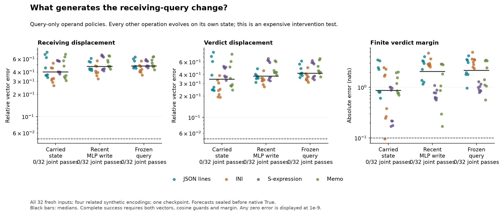
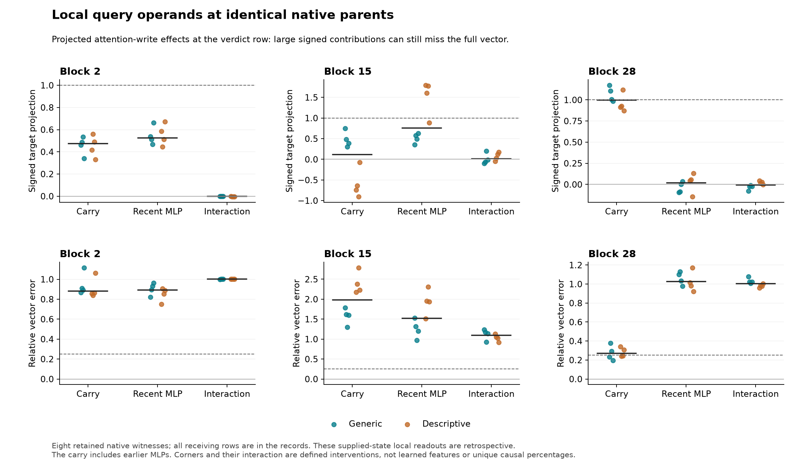

# Neither query-generator operand is sufficient on its own

**Both frozen sufficient accounts fail:0/32 complete native-response successes.**
Letting queries read the current carried state with the previous MLP write held
at False performs better than the complementary policy, but still leaves40.07%
median receiving-vector error and.868 nat margin error. The most-recent-MLP-write
policy leaves47.27% and 2.061 nats. The frozen-query comparator also passes0/32.
The separate conditional query-effect criteria pass0/32 throughout. Question B
remains open; this coarse sufficient-account line is closed.

All **55,280 required numerical checks pass**, including 42,944 pre-native
checks, and all 576 raw query-coordinate diagnostics pass in this experiment.
That does not repair298's160 original narrow failures, historical derivative
disagreements or invalid replacement-agent claims.

## What computation was changed

Before block l>=2, the residual is the previous block's pre-MLP state h plus its
MLP write w, with the actual Float32 addition. An ordinary False observation
supplies hF,wF. Each forecast generates its own current h,w. Only the receiving
query branch is changed, through finite RMSNorm, query projection/bias and rotary:

- **C, carried state:** query from h+wF.
- **M, most recent MLP write:** query from hF+w.
- **B, frozen comparator:** query from hF+wF.
- **N, current generator:** query from h+w, measured natively and by a separate
  current-operand calibration after the public forecast seal.

First-block receiving queries are unchanged because the edit has not reached
their incoming residuals. Source and earlier queries stay protected. Keys and
values receive the unmodified current normalized residual. All MLPs, residuals,
attention operations and the full-vocabulary finite head remain live on each
candidate's own trajectory. All three forecasts exactly match the native first
block in all 32 cases; their remaining errors arise later.

This isolates the MOST RECENT MLP write, not all MLP computation. The carry
already contains earlier MLP outputs, and the current MLP write depends on its
input. Different evolving histories make the final policy interaction
T-C-M+B a defined comparison, not a unique causal allocation or learned feature.
The hybrids can be off manifold. Recomputing nearly the full network is not a
compact explanation of what its learned query directions represent.

## All native results and the frozen decision

Separately pooled medians across32 cases:

- C:40.07% receiving error,34.23% verdict error,.8685 nat margin error.
- M:47.27% receiving error,37.97% verdict error,2.0607 nat margin error.
- B:48.03% receiving error,41.60% verdict error,2.1551 nat margin error.

Each arm has 0/32 strict successes and 0/8 in each encoding. H1 required C to
pass24/32 and 6/8 in EACH encoding, while M/B each passed at most8/32. H2 required
M under the analogous restrictions. Neither hypothesis passes. The native test
requires both receiving and verdict displacements within 5% error with.99 cosine,
norms>=.001,and actual finite-margin error<=.10 nat. No denominator was changed.

C's conditional T-B query-effect errors are84.09% receiving and 78.82% verdict;
M's are98.13% and 91.97%. Better whole-response medians do not establish an
accurate account of the effect of query adaptation itself. Conditional success
also fails0/32 at the predeclared25%/.95/.10 nat bounds and.02 nat materiality guard.

## Why a late local contribution does not explain its generation

Eight cases were fixed in advance: both schemas,order0,target0 in each encoding.
At blocks 2/15/28, save all four query-generator corners at the SAME native
parents with shared K/V. Apply the actual attention output matrix in CPU64 and
measure signed query and attention-write effects at every receiving position.
These local measurements are retrospective; none entered the sealed forecasts.

At block 28 verdict rows, C-B has 99.55% median signed projection onto the local
native N-B attention-write change. Its median complete-vector error is still
26.93%. Earlier blocks differ: at block 2 the carry and recent-write projections
are47.47% and 52.64%; at block 15 they are11.82% and 75.87%, with large remaining
vector errors. These are local defined corners, not percentages of the final
Boolean response. Separate medians do not sum to one.

The useful boundary is concrete: a carry supplied by the native computation can
generate much of the final block's local write, while a carry-only query policy
fails to generate an accurate trajectory leading there. A successful local
readout at a supplied state does not identify that state's upstream generator.

There is a narrower retrospective clue at block 15. The query-corner interaction
has 4.59% median norm relative to the native query change, but the corresponding
attention-write interaction has 49.86% relative norm. Its signed projection is
only.88%. A small projection can therefore coexist with a substantial vector.
This suggests testing where the joint effect is generated: the finite query
normalization or the subsequent nonlinear attention map. The figures and this
norm comparison do not themselves establish that explanation or its final
behavioral importance. No circuit or new general law is claimed.

## Forecast order, numerical scope and cost

The148 scientific sources were frozen at`0c343a2` before checkpoint execution.
32 new full-input pairs,64 complete hashes absent from the available2,368-hash
catalog, use new literals in four related evidence encodings. They remain
dependent synthetic templates on one Qwen2.5-1.5B-Instruct checkpoint. Failed
grounding controls still prevent competent-verifier or deployment-failure claims.

All forecasts, exact zero controls and the pre-audit were sealed publicly at
[`ce3ce24`](https://github.com/romrom-20/counterfactual-traces/commit/ce3ce248d6b1cac9441c3438d3a53965bcfedffa)
before ordinary True measurement. The native process verifies remote head,
public seal bytes, source/runtime identities and every forecast/metadata hash.
Native/current-operand calibration replays every receiving state and score
exactly; source and prefix trajectory checks pass. No threshold was relaxed.

Independent saved-array checks reconstruct operand sums, False anchors, finite
RMSNorm, projection/bias/rotary,QK,softmax,PV and final candidate scores. Coverage
is96 forecast kernels and 48 native/calibration kernels with four corners each,
not an independent reconstruction of all 28 blocks. Required bounds were fixed
before execution: normalized inputs1e-5; query max.01 AND relativeL2 1e-5;
composed probability/output1e-4; finite candidate head.005. The original1e-4 raw
query-coordinate diagnostics all pass,max1.78e-5. Maximum CPU probability and
weighted-value discrepancies are4.08e-6 and 1.80e-5. No derivatives were used.
Same-team arithmetic checks are not independent research-team replication.

Tiny CPU qualification passes2,780 checks across four unequal lengths and 36
random-model forwards, including coherent wrong-operand, False-parent and source
corruption rejection. A prior unfrozen tiny fixture stopped on an old report-key
name after9 forwards; it was corrected before scientific freeze and checkpoint
execution, with the failure retained locally. The standalone reproduction I/O
fixture passes1,390 checks with 18 tiny forwards. Neither is checkpoint evidence.

Actual checkpoint work:224 forecast plus64 native/calibration full forwards,
6,408 additional full-shape RMSNorm calls and 432 extra full query projections,
QK,softmax andPV operations EACH. Original model operations, CPU audits/output
projections and loading also count. The model phases take99.97 s and 32.54 s;
audits4.01 s and 4.39 s on the recorded Mac,including loading/bookkeeping. No speedup
or useful-budget predictor is established.

Forecast/witness archives total278,820,813 bytes,native103,010,694 bytes,shared
query/output weights26,727,208 bytes. All8 GiB reserve and 512/256/64 MiB caps pass.
One shared offline model checkpoint is reused; no model copy, download or old
pipeline repetition was needed. All activation arrays stay local. CI verifies
source ancestry,seals,record integrity,complete counts and scalar/vector
arithmetic; it does not independently reconstruct omitted activation arrays.

[Frozen protocol](../experiments/299-query-generators.md) ·
[All records](../../results/query-generators-299/README.md) ·
[Reproduction](../../research/README.md#query-generator-operands-299).
