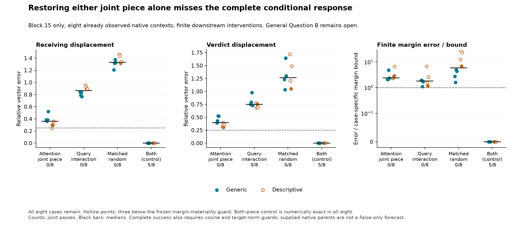

# A joint write has two sources; neither alone recovers the conditional response

**Both sufficient accounts fail: 0/8 complete conditional successes.** Restoring
the nonlinear attention-integration piece leaves 36.12% median final receiving
error; restoring the transmitted query-generator interaction leaves 86.63%.
The matched random control leaves 133.23%. Restoring both replays the native
trajectory exactly in every case. Only five of the eight conditional margin
effects are material, so the full calibration's scientific count is 5/8; the
other three remain failed in every denominator.

This is a **retrospective block-15 diagnostic at eight known native contexts**.
It does not explain all 299 failures, predict from False alone, identify a
learned circuit or solve general Question B. All 864 required checks and all
40 original raw coordinate diagnostics pass. Older failed checks remain failed.

## The causal question after 299

[299](299-query-generators.md) rejects both simple query-generator operand
policies on fresh inputs. At its fixed native middle-block witnesses, however,
the query-corner interaction has only 4.59% median norm relative to the local
native query change, while the attention-write interaction has 49.86% relative
norm. Those are different vector spaces, not an invariant gain measurement.
They suggest a narrower question: is the joint write mostly generated while
forming the query, or while attention integrates the two query components?

For the same native parents, let qN be the actual query, qC the query with only
the carried state updated, qM with only the most recent MLP write updated, and
qB with both operands False. Define qA = qC + qM - qB. Let f(q) apply attention
with shared native keys/values and the learned output projection. Then define:

    WN = f(qN), WA = f(qA), WC = f(qC), WM = f(qM), WB = f(qB)
    L = WC + WM - WB
    WN - L = (WN - WA) + (WA - L).

The first piece is the query-generator interaction transmitted **through**
attention. It includes finite query-normalization interaction, and rounding;
projection and rotary are affine/linear. Its effect also depends on attention.
The second piece is the nonlinear integration of the query components by
attention itself. This is a decomposition of a defined local discrepancy, not
two independently learned features or a unique allocation of the Boolean effect.
The code uses the declared Float32 addition/subtraction order.

## Why nearly additive queries can produce a joint write

There is a simple architectural reason. Ignoring rounding, attention scores at
shared keys add when queries add. But softmax exponentiates and renormalizes
them. On allowed keys, the additive-query distribution therefore satisfies

    pA(j) = normalize_j [pC(j) * pM(j) / pB(j)].

The query components combine multiplicatively in attention probabilities, then
compete through the common normalizer. The changed probabilities weight learned
value vectors and generate a joint residual write. Query additivity does not
imply attention-write additivity. This identity is ordinary softmax algebra,
not a new discovery or a separate empirical result. It explains how the local
interaction can be generated without explaining the learned query/value contents.

## Restore the pieces, then run the actual suffix

Only the receiving attention-output writes at block 15 are changed. Earlier
blocks remain native, source and prefix rows are protected, and all later
attention, normalization, MLPs, residuals and the full-vocabulary readout run
finitely. The native parents and queries are explicitly supplied, so this is
never a False-only forecast.

- **L:** additive corner writes, with both joint pieces absent.
- **A:** WA, restoring the attention-integration piece.
- **R:** L + (WN - WA), restoring the transmitted query-generator interaction.
- **J:** L plus a seeded random residual vector, matched to the joint target's
  norm at every receiving row.
- **O:** WN, restoring both; exact native calibration.

The target is the final conditional displacement between native T0 and L, not
the complete input-Boolean displacement. Native T0 is deliberately repeated
and verified against every saved 299 receiving trace and score before the five
conditional continuations. A mismatch would save partial evidence and stop
after one full forward. The O trajectory also replays T0 exactly in all eight.

At the intervened verdict write, A has 40.77% median vector error and 71.13%
signed target projection; R has 77.81% error and 28.87% projection. Their
directions and magnitudes differ. Those projections do not establish complete
recovery. All receiving-position statistics, not just verdict rows, are retained.

After the complete finite suffix, separately pooled medians are:

- A: 36.12% receiving error, 39.44% verdict error, .02896-nat margin error.
- R: 86.63% receiving error, 75.10% verdict error, .01067-nat margin error.
- J: 133.23% receiving error, 126.72% verdict error, .05232-nat margin error.

R has smaller median scalar error while recovering a much worse vector. Neither
passes the finite-margin component in any of the five material cases under the
case-specific bound. The conditional native margin changes range from .00455
to .17950 nats; this is a small, defined local intervention, not a fraction
allocation of the full Boolean response.

Complete success requires receiving and verdict target norms >= .001, relative
errors <= .25, cosines >= .95, a margin effect >= .02 nat, and actual margin
error <= min(.10 nat, .25 times the effect). The frozen population criterion
requires at least 6/8, 3/4 in each schema and 1/2 in every encoding, with the
other piece and random control each <= 2/8. With only five material cases, the six-case population threshold is unattainable; both hypotheses fail. Low-effect
cases and favorable medians cannot rescue either.

The final suffix interaction T0-A-R+L has 2.61% median receiving norm and 1.54%
verdict norm relative to the conditional target. In this test, a large new
joint term created after block 15 is not needed to explain the failure of either
single-piece restoration. Both already contribute to the intervened write.
This does not rule out later nonlinear effects elsewhere in the full response.

## What this does and does not explain

The intervention supports a concrete, bounded account of this joint write:
attention's nonlinear integration contributes substantially, while the
query-generator interaction transmitted through it cannot be omitted under the
frozen complete-response criterion. Their restoration together is an exact
calibration by construction, not a discovered shortcut. The defined native
components and their particular value directions are still supplied.

We therefore have a conditional operation-level explanation, with finite causal
tests, rather than an account of why this model learned these schema-dependent
query and value directions. The next meaningful step would need a frozen
hypothesis about those contents and a restricted prediction budget on new inputs.
Another layer/threshold sweep would not answer that question. This sufficient-
account line is closed.

## Qualification, reproducibility and limits

All 154 scientific source bytes were frozen at `2938191` before the new
checkpoint interventions. The eight inputs and block selection are explicitly
posthoc descendants of 299, not new population confirmation. One small pinned
checkpoint, dependent synthetic templates and failed grounding controls still
constrain interpretation. No competent-verifier shutdown or priority claim follows.

The separate CPU64 audit reconstructs all five query-conditioned probability,
weighted-value and output-map paths, the intervention identities, installed
random norms and finite candidate heads. Original raw projected-write error is
at most 8.10e-6 against 1e-4. The maximum CPU scaled write-contrast discrepancy
is 3.54e-5, below the predeclared 1e-3 bound. Broader projected-write bounds also
require max <= 1e-3 and relative L2 <= 1e-5. Native replay is exact. These checks
are same-team numerical qualification, not an independent research team or
whole-model reconstruction; no derivatives were used or recertified.

The tiny CPU fixture passes 432 checks across four unequal lengths. It uses 36
parent-generation, 24 diagnostic and four deliberate stopped-control forwards,
rejecting coherent wrong-primitive substitutions and doubled random controls.
The standalone reproduction I/O fixture passes 216 checks using 18 tiny parent
and 12 diagnostic forwards. Neither is checkpoint evidence. Checkpoint parent
bootstrapping in the reproduction wrapper is available but was not executed here.

Production uses 48 full checkpoint forwards: eight repeated native calibrations
and 40 conditional continuations, plus eight extra full QK/softmax/PV kernels
and 32 extra output projections. Host audits and matrix work are additional.
Production takes 21.20 seconds and audit 2.82 seconds on the recorded Mac,
including loading/bookkeeping; no speedup claim is made. Case archives total
38,671,810 bytes, below the 64 MiB cap. One shared offline model checkpoint and
the 8 GiB reserve are used; no old forecast pipeline or pruned arrays were restored.

The standard-library verifier checks source ancestry, parent seals, complete
denominators, costs, numerical records, signed sufficient statistics, finite
margin arithmetic and figure provenance. Weights and native arrays stay local;
record verification is not independent replication of their computation.

[Frozen protocol](../experiments/300-query-interaction.md) ·
[All records](../../results/query-interaction-300/README.md) ·
[Reproduce](../../research/README.md#native-query-interaction-300).
