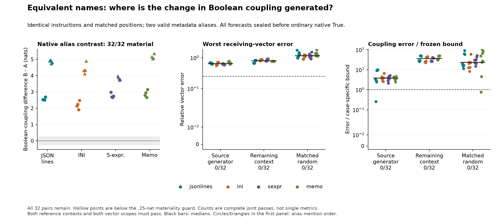
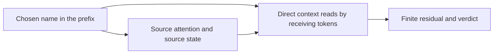
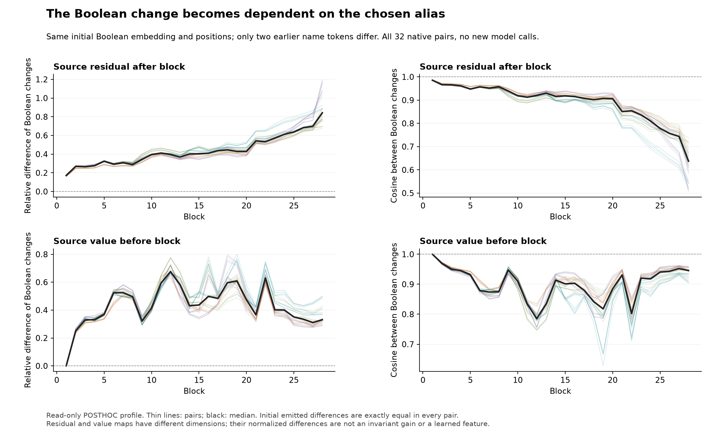
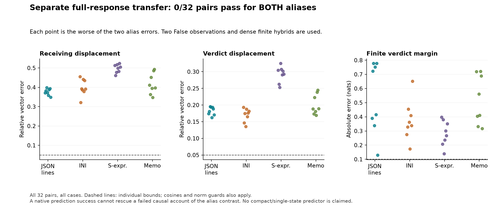

# An equivalent metadata name changes the Boolean response from the first source block

**Changing only the chosen metadata name changes Boolean coupling in all 32
matched task pairs.** The instruction explicitly declares `first_value` and
`record_flag` interchangeable aliases for irrelevant metadata. Everything else
within a pair—including instruction text, task, sequence length, absolute token
positions and final `supported` field—is identical. The coupling contrast is
1.903–5.349 nats, median **3.438 nats**, and has the same sign under both alias
mention orders. This is a controlled spelling effect under this instruction,
not proof of what caused every older whole-schema difference.

The causal explanation remains incomplete. A crossed-prefix intervention
generates the other alias's source state and emitted values **exactly at every
layer**, while retaining the recipient's direct context reads. Neither the
source-generator-only nor remaining-context-only account predicts the complete
alias contrast: both pass **0/32**. Every target is material, so this failure is
not caused by a low-effect denominator. General Question B remains open.



## The input cause is narrower than the earlier schema comparison

Earlier studies crossed field names and controlled some lengths, but recent
source/receiver interchanges used entire prompt backgrounds that differed in
instructions, both field names and positions. A failed transplantation across
those backgrounds could not identify which difference generated the changed
direction. This study isolates one chosen name under a shared instruction.

The instruction permits either metadata alias, with the same arbitrary role and
no meaning about correctness. The supplied completion uses one of these forms:

```text
{"first_value": <bit>, "supported":
{"record_flag": <bit>, "supported":
```

`<bit>` is the supplied False or True token. Both names occupy two tokens and
exactly the same positions. Alias choice changes only those two token IDs;
changing the bit changes one further ID. The final field stays `supported`.
Alias mention order in the instruction, fact order and question target are
counterbalanced across four related evidence encodings. There are 32 task pairs,
128 complete input hashes absent from the available 2,432-hash catalog.

Let m be the finite true-versus-false candidate-score margin. For alias X,
Boolean coupling is C_X = m_X(True prefix) - m_X(False prefix). The reported
alias contrast is K = C_B - C_A. It measures a change in the bit's influence,
not just a different baseline preference. The median 3.438-nat contrast means
about a 31-fold ratio between the two bit-induced conditional-odds multipliers;
it is not a 31-fold truth probability or an accuracy claim.

For the first preregistered task pair, the margins are -1.288 and 2.469 under A,
versus -2.664 and 3.626 under B. Their bit couplings are 3.756 and 6.290 nats, with
a 2.533-nat contrast. This example was selected by fixed input order. All 32
contrasts, not a favorable example, determine the criteria.

These remain synthetic conditional-score tasks in one small model. The older
grounding controls failed. Valid output names and changed preference margins do
not establish reliable verification, unrestricted decoding or a deployment failure.

## Route the name to the source separately from its readers

The source is the earlier Boolean token. A is the `first_value` background and
B the `record_flag` background. At each layer, source attention can read the
short prefix tail containing the selected name. Everything before the first
changed name token is causally identical between A/B. Everything before the
Boolean is also identical under the False and True bit.

Two ordinary False observations therefore supply the prefix K/V needed for both
bit values. In hybrid AB, keep A's actual inputs and direct receiving-context
reads, but use B's observed prefix-tail K/V **only when computing the source
query's attention output**. Current source query/self-K/V, all MLPs, norms and
residuals stay finite. Install only the source attention result; every other
query output is untouched. BA reverses the roles.



By causality, this generates the complete donor source trajectory without
borrowing a native True receiving state. False donor-source matching is checked
before the public seal; True matching is checked after native measurement.
Both source states and emitted source values match exactly at all 28 layers.
Zero-alias controls replay False exactly. Self-prefix controls replay native
True at every saved source/receiving coordinate and both candidate scores.

The receiving hybrids are artificial interventions and may be off manifold.
Source centers and Boolean differences change together. These routes do not
identify a pure truth feature, semantic neuron or unique learned circuit.

## Both reference contexts matter

Let D_rs be the final True-minus-False displacement with receiving background r
and source-generator background s. Let C_rs be the corresponding finite margin
coupling. The native alias target is T = D_BB-D_AA, with K = C_BB-C_AA.

- The source account predicts T using BOTH D_AB-D_AA and D_BB-D_BA.
- The remaining-context account uses BOTH D_BA-D_AA and D_BB-D_AB.
- A seeded source-prefix random control at A matches the actual prefix K/V
  change's norm per layer, KV head and tail position, and is reused for both bits.

Both reference contexts, receiving and verdict vectors must pass 25% relative
error, .95 cosine, target norms >= .001, |K| >= .25 nat, and actual coupling-contrast
error <= min(.10 nat,.25|K|). The population rule requires 24/32, 6/8 in every layout
and 12/16 in each mention order, with the competing account/random each <= 8/32.
All cases remain in the denominator. Neither hypothesis passes a case (0/32 each); random also passes 0/32.

Separately pooled medians, taking the worse reference context per pair:

- Source generator: 64.06% receiving error, 39.47% verdict error, .3834 nat margin error.
- Remaining context: 79.78%, 94.86%, 3.6575 nats.
- Matched random: 117.44%, 119.53%, 2.3359 nats.

The source route is closer in its scalar response. Its two signed coupling
changes have medians 3.248 and 3.657 nats; the remaining-context changes have medians
-.0129 and .3079 nat. The coupling interaction median is .2446 nat. Separate medians
do not add to the native 3.438 nat median. These are defined conditional effects,
not unique percentages of a behavior or signs of competing learned features.

At the verdict, source_A's signed vector projection is 86.51% of the alias
contrast, while its vector error is 39.38%. The interaction has only 4.00% median
signed projection but 23.18% relative norm. Thus a large projection or a small
interaction projection cannot establish a complete vector explanation.

## The name dependence is already present at the source

A read-only **posthoc** profile uses the saved native arrays, without any new
model calls. It compares the actual Boolean-induced source displacements under
the two aliases, and separately their emitted value differences. All 32 pairs
and all 28 layers remain; this is not a selected-layer success criterion.



Before attention 1, the source value difference is exactly identical across
aliases in every pair: the Boolean embedding and position are the same. After
the first source block, however, its residual displacement differs by 17.12% at
the median, cosine .9856. The next value emission differs by 25.04%, cosine .9696;
its median B/A norm ratio is 1.025. The dependence is therefore visible in the
source residual before later receiving processing, and not only in the final
readout or emission normalization.

Alias information can enter that first source block through attention to the
earlier prefix; its normalization and MLP are token-local. This localizes the
first generation step, but does not separate the particular attention-key,
value, normalization or MLP contributions. The subsequent emitted-value map
also matters. Residual and value spaces have different dimensions; their
normalized differences are not an invariant amplification factor.

This supports a concrete partial account: the source's Boolean response depends
on the chosen name, and an exactly generated source trajectory still does not
make the receiving response portable between those names. It does not establish
why the learned weights produce the particular directions or how to predict
them from a substantially restricted False-state summary.

## A separate full-response forecast also fails

Before native measurements, the rule transfers a hybrid Boolean response onto
the other ordinary False endpoint, then applies the actual finite final norm
and full vocabulary head:

    P_B = Float32(B_F + AB_T - AB_F)
    P_A = Float32(A_F + BA_T - BA_F)

The expression is evaluated in Float64 before its one Float32 cast. This uses
two complete False observations, known edits and dense finite hybrid forwards.
It is not a single-False or compact predictor. Both aliases must meet the
original native 5%/.99/.10 nat criterion for a pair to pass.

The rule passes 0/64 individual alias predictions and 0/32 pairs. Median worst-
alias receiving error is 39.79%, verdict 18.86%, margin .3851 nat. Correct source
generation alone does not recover the full response through the other context.
This rejects the specified transfer rule, not counterfactual prediction in
general: the earlier causal-suffix reuse baseline remains the accurate reference.



## Seals, numerical caveats and actual work

All 163 scientific sources and criteria were frozen at `4b32dac` before checkpoint
execution. All forecasts, controls and the 46,080-check pre-audit were public at
[`e9f23b6`](https://github.com/romrom-20/counterfactual-traces/commit/e9f23b670e471a0a2c053aa525dd50a7b2d507d1)
before ordinary native True endpoints. The native process verifies remote head,
public seal bytes, source/runtime identities and every forecast/metadata hash.
No tolerance, case, population rule or materiality guard changed after results.

The final audit passes 60,352 required checks, including the prechecks. It
independently reconstructs routed prefix inputs, CPU64 source attention/value/
output maps, random norms, finite heads and all declared identities. Witness
coverage is 192 forecast plus 96 native kernels: eight fixed task pairs at
blocks 1/15/28. It is not an independent full-model reconstruction or team replication.

**96/576 original raw coordinate diagnostics remain failed** at 1e-4: all 96 are
scaled-QK comparisons among 288 such checks, maximum .001471. All 288 raw output-
projection comparisons pass, maximum 4.09e-5. Required composed probability/value
output bounds were separately declared at 1e-4; maximum errors are 1.31e-5 and 1.20e-5.
Projected-source max 1e-3 AND relative L2 1e-5 and finite-head 1e-4 bounds also pass;
maximum finite-head discrepancy is 7.65e-6. No failed raw check is relabeled or
old derivative disagreement recertified. No derivatives are used here.

The final tiny CPU qualification passes 2,424 records, 56 tiny forwards, 13
corruption/immutability tests and known source-only/remaining-only/joint causal
tables. An earlier unfrozen passing fixture before adding the algebra tables is
retained; it adds 56 development tiny forwards. The standalone I/O fixture adds
28 tiny forwards and 1,212 checks. It explicitly repeats public numerical inputs,
not the original globally sealed study. None of these is checkpoint evidence.

Actual checkpoint budget: 320 forecast-phase plus 128 native/control full
forwards, 448 total. The latter includes 64 ordinary True endpoints and 64
self-prefix controls. Source-prefix replacement adds 8,960 full QK/softmax/PV
recomputations EACH, plus 288 witness full QK products. The two transfer endpoints
per pair add 64 full final norms and 64 full vocabulary heads. CPU audits and
posthoc profiles add host work. No speedup or useful-budget predictor is claimed.

Model phases take 127.80s and 50.54s; audits 4.00s and 4.69s on the recorded Mac,
including loading/bookkeeping. Forecast/witness archives total 391,484,221 bytes;
native 185,553,710 bytes. The 512/256 MiB caps and 8 GiB reserve pass. Only short
alias-dependent cache tails are saved; one shared offline checkpoint is reused.
No old model experiment or intentionally pruned arrays were regenerated.

CI checks source ancestry, immutable releases, input controls, complete counts,
signed sufficient-statistic arithmetic, finite margin decisions and figures.
Weights/native arrays remain local. Record verification does not independently
repeat the checkpoint or validate every primitive. Private article drafts remain local.

The frozen source-only and remaining-only sufficient accounts are closed.
Further progress needs a specific primitive account of how the first source
context read and MLP generate the observed name-conditioned residual change,
or a useful restricted prediction budget. Another arbitrary layer/alias/rank
search would not answer that question. No learned circuit or novelty priority
has been established.

[Frozen protocol](../experiments/301-equivalent-alias-source-routes.md) ·
[All evidence](../../results/alias-source-routes-301/README.md) ·
[Reproduction](../../research/README.md#equivalent-alias-source-routes-301).
