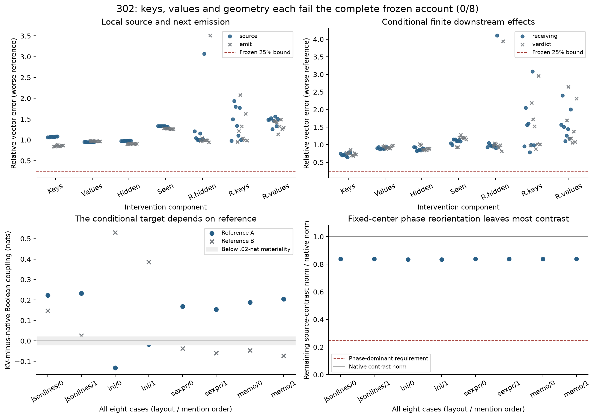
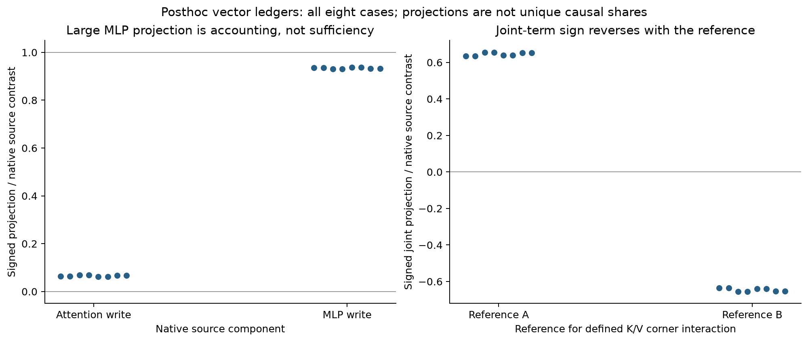

# The first source contrast does not reduce to keys, values or a positional phase

**The key-only, value-only and False-query-invisible-key sufficient accounts all
fail: 0/8 complete conditional tests, and 0/8 source/emission-only tests.**
The fixed-center phase-orientation account also fails in every case. Its
intervention leaves a median **83.85% of the native first-source contrast norm**.
These are eight already observed native contexts, not a new forecast population.

A complete first-source key/value replacement reproduces the other alias's first
source state and next emitted value exactly. The finite network after that site
continues normally. This qualifies a precise intervention boundary; it does not
make any single tested component a sufficient explanation or solve Question B.

## What was controlled

301 established that choosing between two explicitly interchangeable metadata
names changes the bit's influence under identical instructions, tasks, lengths
and positions. Its native source displacements first differ after block 1.
This study uses the eight originally fixed 301 witness task pairs: four layouts
and two alias-mention orders, with fact order and target fixed. Both Boolean
endpoints are already known. This is a retrospective mechanism diagnostic.
Historical grounding and label-reversal controls failed; these conditional
scores do not establish a competent verifier or a semantic truth circuit.

At the first block, each fixed Boolean has the same query and self key/value
under both aliases. Only the two name-token prefix rows change. K replaces their
keys; V their values; KV both. Only the Boolean source's first attention output
is installed. Other first-block query outputs are protected. The source MLP,
all later attention/MLPs/residuals and the final norm and vocabulary head remain
finite. False and True are run for every intervention and both alias contexts.

H splits the native key difference into the joint nullspace of every False
source-query head sharing a KV bank. S is the complementary component. H is
invisible to the False source queries in exact arithmetic, while the changed
query may read it. Seeded RK/RV/RH controls match key/value/hidden-key norms per
KV head and edited row; RH is also False-query-invisible. These are artificial
interventions, not discovered learned features or natural token substitutions.

P preserves the A/B key center and rotates only their difference to zero its
name-token-relative source phase. G rotates the query and all visible keys
commonly as an invariance control. P does not remove all RoPE, and rotary phase
is part of key geometry rather than a mutually exclusive third pathway. Matched
positions already exclude a changed-position-only explanation of 301. No
long-context out-of-distribution mechanism is claimed for these short inputs.

## The conditional target is not the whole native response

For recipient r, let D[arm,r] be the arm's measured True-minus-False response.
The two reference targets are defined separately:

    E_A = D[KV,A] - D[N,A]
    E_B = D[N,B] - D[KV,B].

At the source, these equal the native alias contrast by exact donor matching.
Downstream they are the effects of changing this ONE source read in the current
receiving context. They are not the complete native Boolean displacement or the
whole-schema difference. Each candidate replaces KV in the same signed formula.
Its False hybrid endpoint is measured, not silently replaced by native False.

A complete case requires both references, source and next-emission vectors,
final receiving and verdict vectors within 25% relative error and .95 cosine;
target norms at least .001; finite coupling effect at least .02 nat and error
at most min(.10 nat,.25*effect). Population requires 6/8, at least one per layout
and three per mention order, with the declared rival/random controls at most two.
All eight remain denominator. Seven have material effects in both references.
The local vector accounts fail throughout, so the outcome is not explained only
by the one below-materiality case.

Median errors, taking the worse reference within each case:

- Keys: source **107.60%**, next emission 85.58%, receiving 72.02%, verdict 75.19%;
  conditional margin error .1188 nat.
- Values: source **94.71%**, next emission 97.01%, receiving 90.04%, verdict 93.64%;
  margin error .2117 nat.
- Hidden keys: source **97.65%**, next emission 90.58%, receiving 87.83%, verdict
  88.07%; margin error .2012 nat.

Seen keys and all three random controls also pass 0/8. All individual outcomes,
signed vector statistics and reference-specific margins are retained. The
conditional margin effects can have different signs in the two receiving
backgrounds; a scalar summary is not a shared final-verdict percentage.

## The MLP writes most of the projection; the interaction is reference-dependent

A native signed ledger gives median attention and MLP projections of 6.60% and
93.40% onto the first-source contrast. This is accounting across the actual
writes. The MLP-only vector still has 28.00% median error, and the MLP receives
the state produced by attention. A large projection neither identifies why the
vector was generated nor establishes a sufficient native mechanism.

A separately labeled **posthoc** ledger uses the already measured K/V corners:

    I = h(KB,VB) - h(KB,VA) - h(KA,VB) + h(KA,VA).

The Boolean difference of this source interaction has median norm 1.044 times
the native source contrast. Its signed projection is +.646 at reference A and
-.646 at reference B. The sign reversal follows from the reference convention;
it is not evidence of opposing mechanisms or a unique causal allocation.
Attention and MLP interaction ledgers are retained separately, with their explicit
normalizers. No interaction-removal experiment is claimed. Ordinary attention
probability/value multiplication and nonlinear MLP processing permit this result.
The ledger does not establish which learned content makes this case occur.

This is why the failures of K and V alone cannot be promoted into a claim that
the mixed term is a discovered circuit. The artificial hybrids separate two
projections of the same changed word embeddings. A complete native token change
moves both coherently. Natural-input controls would be needed to distinguish a
learned content account from sensitivity to mismatched key/value pairs.

## Numerical qualification and retained failures

All 168 scientific sources and criteria were committed at
`664931fa144c49d6510d05b46752bedbcda764a0` and pushed before new checkpoint
execution. All previous 163 sources remain byte-identical. The final synthetic
qualification passes 1,806 records, 140 tiny forwards and eight corruption checks,
including coherent wrong-key/value full continuations, single-query-only
nullspaces and wrong phase norms. Unequal GQA, sequence and MLP widths are used.
Known key-only/value-only/joint tables check signs and both-reference decisions.
An earlier unfrozen passing fixture before formatting adds 140 development tiny
forwards and is retained. The standalone tiny dispatch fixture adds another 140.

All 32 ordinary native calibrations replay every saved receiving/source trace
and both scores exactly. The separate calibration audit passes 1,600 required
checks before any new interventions. The final audit passes **8,000 required
checks**, including the calibration scope.

**384/768 original raw coordinate diagnostics remain failed**, all scaled-QK
comparisons at 1e-4, maximum .00147020. All 384 output-projection diagnostics pass,
maximum 7.42e-6. Required predeclared composed probability/PV errors are at most
1.30e-5 and 1.05e-5 against 1e-4. First-MLP max error is 6.20e-6, next value
1.84e-6 and finite head 7.71e-6. Independent complex rotation and pinv checks
qualify the production rotary and joint-query SVD constructions.

H/RH False probability changes are at most 3.97e-6, first-source changes 7.40e-6.
G's maximum score discrepancy is 6.87e-5 under its separately declared 1e-3 bound.
SELF and complete donor-source/next-emission controls are exact. This is selected
finite arithmetic in the same investigation, not independent whole-model/team
replication. No derivatives are used or recertified. 301's 96/576 failures and
older derivative disagreements remain unchanged.

## Work, reproduction and the resulting boundary

The run uses 384 full checkpoint forwards: 32 deliberate native calibrations and
352 conditional continuations. It adds 736 full QK products and 352 full softmax
and PV calculations; host audits and tiny-model qualification are additional.
No speedup or compact False-only predictor is claimed. New activation archives
are about 31 MiB, below the 128 MiB cap, with an 8 GiB free-space reserve. One
shared offline checkpoint is reused; no full model or MLP weights are copied.

[Standalone reproduction](../../research/README.md#first-source-geometry-302)
can use original 301 parents, or regenerate only the eight required known parent
contexts in a new directory. The latter adds 112 forwards for 496 total, plus 2,240 parent attention
recomputations, 288 parent QK witnesses and 16 additional finite norms/full heads.
It is numerical repetition on known public inputs, not fresh confirmation. The original
checkpoint bootstrap route was not executed again for this report.

The tested key-only, value-only, hidden-key and phase-dominant accounts are now
closed under their frozen definitions. A useful next step must explain the
native learned content or predict it under a genuinely restricted information
and work budget. Another arbitrary projection/phase/rank sweep would not do so.
Question B remains open; no learned circuit or novelty priority is established.

[Frozen protocol](../experiments/302-first-source-geometry.md) ·
[Complete evidence](../../results/first-source-geometry-302/README.md).
