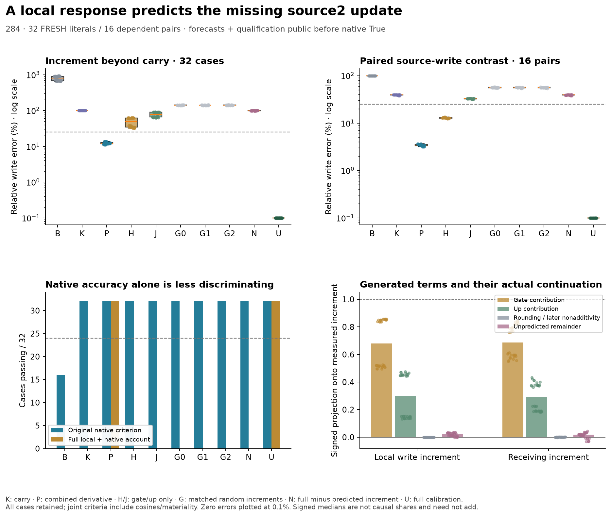

# Sealed fresh carried-state response: Experiment 284

**The fixed P rule passes its frozen joint criterion in 32/32 fresh literal
contexts, with 8/8 in each schema/order stratum and 16/16 dependent paired
contrasts.** All forecasts and their numerical qualification were published
before any native True measurement. Complete native outcomes and the separate
qualified continuation are now included; the immutable forecast records remain
unchanged.

[Frozen protocol](../../docs/experiments/284-sealed-carried-response.md) ·
[Readable result and limits](../../docs/analysis/284-carried-state-response.md) ·
[Reproduce](../../research/README.md#carried-state-response-283284) ·
[Unchanged method](../../research/boolean_coupling/carried283.py) ·
[Forecast/native source](../../research/boolean_coupling/run284.py)

The forecast-manifest binds scientific source, inputs and every published
forecast/qualification record. forecast-seal.json binds all 32 saved forecast
arrays, their metadata, design and audit. No large arrays or checkpoint weights
are published; forecast-array-inventory.json records their exact hashes/bytes.
All forecast aliases are local and lossless.

The forecast seal was public in commit
`c2439037904cf6d6c9eb4cb91c38301f4f12f6f5` before C1/U/N/T. The
first-native receipt remains in `native-started.json`. The forecast manifest
excludes this presentation README, which can describe later audited outcomes;
its scientific sources, inputs, qualification and seal are immutable.



## What passes, and what remains failed

P passes the conditional C1-K local-increment test 32/32, with 12.00% median
relative error and .99290 cosine. Its paired local schema contrast passes 16/16,
with 3.42% median error. Gate-only H, up-only J and norm-matched random increments
pass the conditional increment 0/32; H nevertheless passes the paired contrast
16/16. Full C1/U are exactly equal positive controls.

Native accuracy alone does not identify this account. K/P/H/J/G0/G1/G2/N all pass
the original native-response criterion 32/32. P's median receiving-vector error
is .231%, verdict-vector error .184% and actual finite-margin error .00234 nat.
All finite later source/receiving operations and an extra finite corner remain;
this is a bounded prediction under a substantial budget.

Every strict incremental continued-effect account is 0/32, including exact
C1/U calibration; the full-removal account also has 0/32 passes. All C1-K margin
effects are below the frozen .02-nat materiality guard, so eligibility is 0/32.
No control rescues the primary, no ineligible case is dropped, and the guard is
unchanged. This is not evidence that the increment is materially necessary for
the native verdict. Native T has a different source1 input and is not the
positive control for the conditional C1-K increment.

A posthoc same-schema cross-literal donor comparison passes the conditional local
tolerance 30/32 without rescaling: 21.33% median error, cosine .97812. Scaling to the
recipient's own **forecast** norm yields 30/32 at 20.87%; it never uses target norms.
Cross-schema donors pass 0/32 in both forms. Donors hold assignment, order and
target fixed. The own rule is more precise, but its particular case-derived
vector is not shown necessary to meet this tolerance. [Transport records](transport-posthoc/summary.json)
retain all 128 donor rows, which reuse 32 recipients/16 dependent pairs. This is
posthoc, zero-forward and has no causal install or native-response comparison;
neither portability nor sign regimes identifies learned features or a circuit.
[Posthoc reproduction commands](../../research/README.md#posthoc-carried-write-portability)
accept an ordinary complete audited 284 repetition or validate its 284b
qualification when present, with no new model forwards.

## Numerical qualification and retained runtime failures

All **4,672 forecast qualification checks** pass under the declared staged
smooth-surrogate/public Float32 scope. **Eleven of 224 raw up comparisons remain
failed at their original 1e-4 bound.** They are retained diagnostics with the
predeclared rounding-envelope qualification, not silently passed comparisons.
No native True or full-current source2 activation was evaluated before the seal.

The unchanged original native audit passes **1,024 required checks**, with
128 finite full-vocabulary head replays and 32 ordinary True full forwards
without editing hooks. The separate 284b wrapper also passes, binding the
original public receipt, retained storage stop and 17 exact replay hashes.
Separate code paths are not an independent research team or a rounded whole-block
Jacobian validation.

The original native producer stopped at its 512-MiB storage reserve after
17 complete cases/68 forwards. The first two cache-continuation attempts stopped
after model loading and before any forward. All three failures remain in
`retained-native-stop/` and `retained-continuation-stops/`, with logs and inventories.
The third continuation reproduced all 17 NPZ **and JSON files exactly before**
measuring the remaining 15 cases. Only unused MPS cache handling changed;
predictions, scientific criteria, numerical scope and reserve did not.

Actual production is 320 forecast plus 196 native forwards, including the
68 original, 68 replay and 60 new native calls. There are 32 unique native cases
and 49 ordinary True producer calls; the 32 unhooked audit calls are additional.
Forecasts also use 32 extra finite corners, 64 local down maps, 32 normalizer
JVPs and 64 CPU64 gate/up matrix-vector products. Arrays remain excluded;
forecast/native/replay inventories bind their exact hashes and byte counts.

## Inspect and verify

`forecast_*.csv` and `forecast-audit.json` preserve pre-native qualification.
The endpoint CSVs (`native`, `local`, `effect`, `incremental`, `incremental_effect`,
`paired`, `joint`, `removal`) preserve every arm and denominator. `ledger.csv`
contains signed finite intervention effects and explicit nonadditivity, not
causal fractions. `native-audit.json`, `native-continuation-audit.json`, completion
statuses, case metadata, inventories and execution notes bind the completed
measurements. Paired whole-token receiving contrasts remain unavailable because
the schemas differ in length; no token alignment is invented.

```sh
python -S research/boolean_coupling/verify_carried_forecasts.py
python -S research/boolean_coupling/verify_carried_results.py --experiment 284
```

These commands check published source/seal/evidence integrity and endpoint
accounting, not independent model replication. Fresh literals share one small
checkpoint and dependent templates. No efficiency, learned-circuit, priority,
competent-verifier shutdown or complete Question B claim follows. Weights,
large arrays, private articles and local working context remain excluded.
